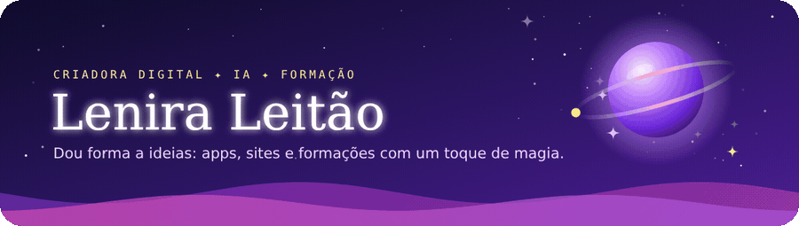
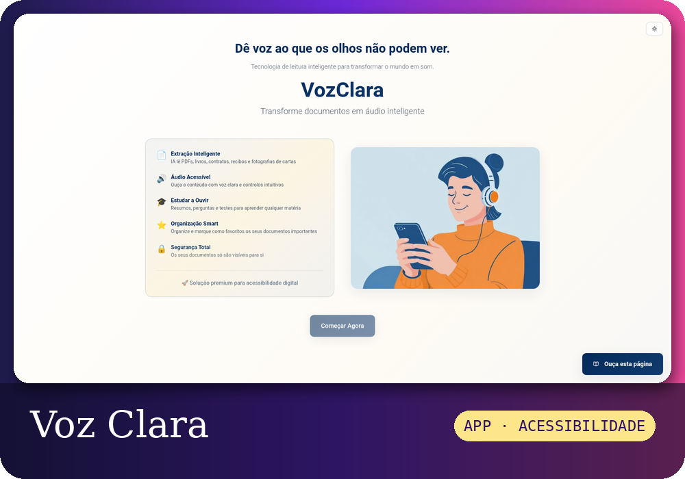
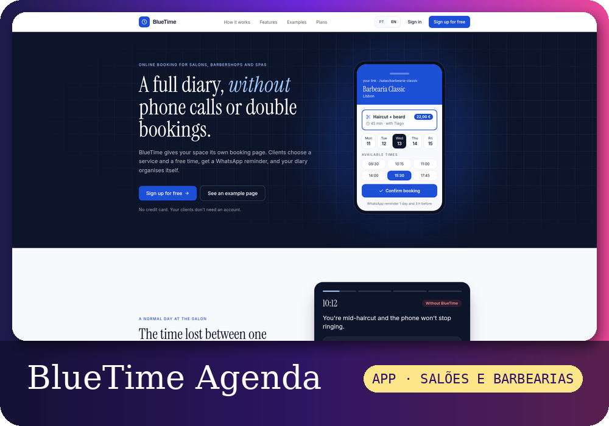
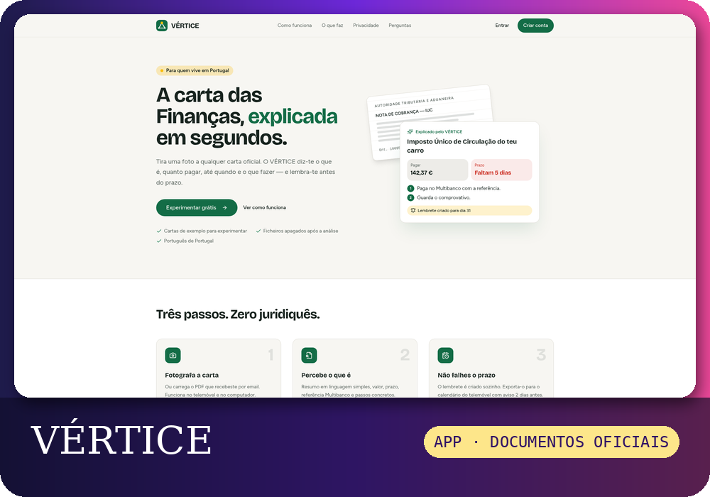
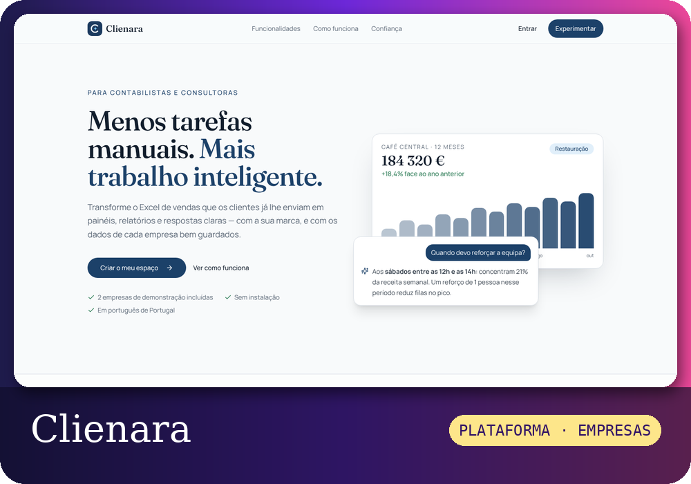
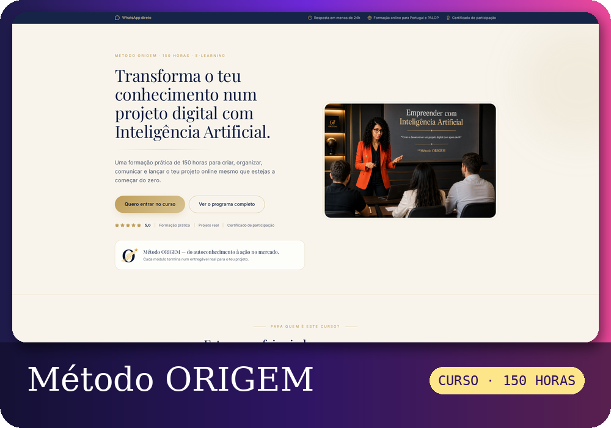
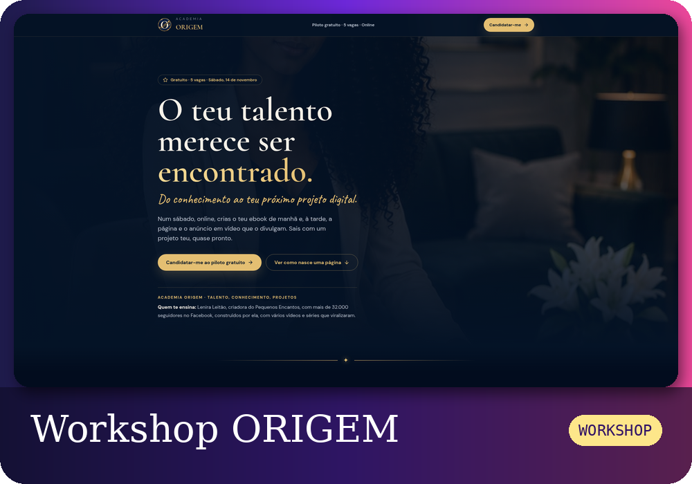
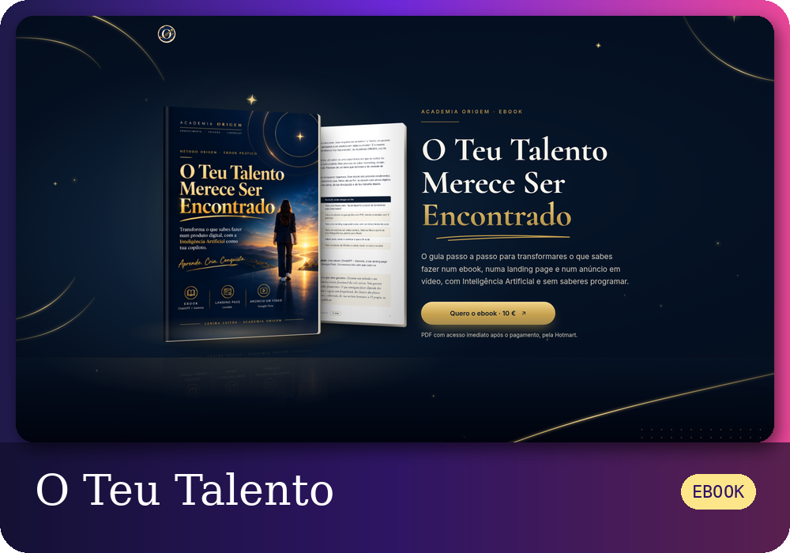
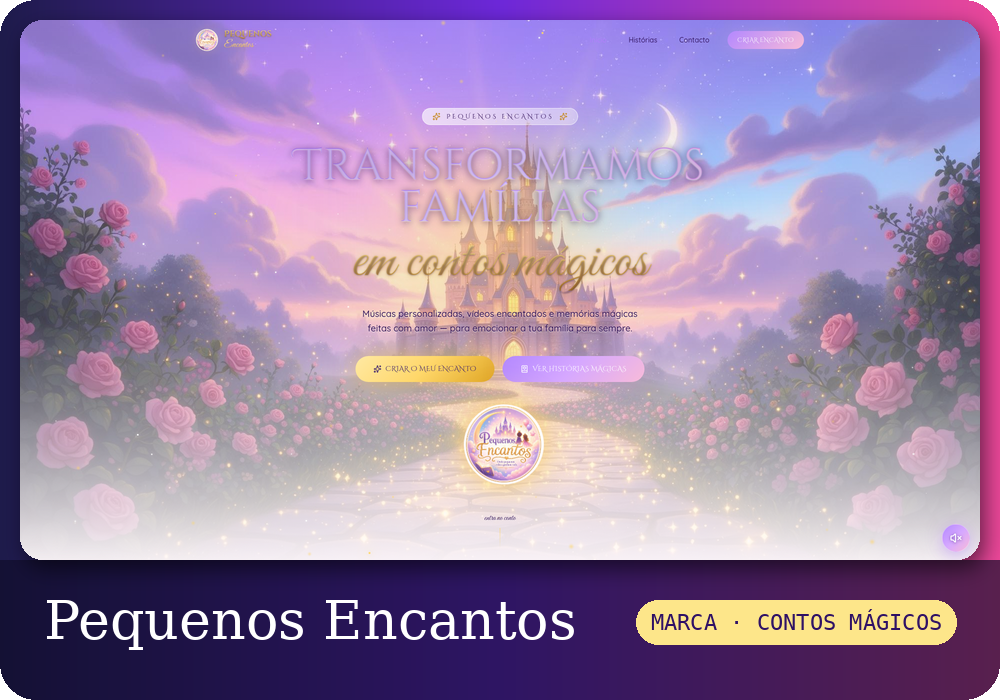
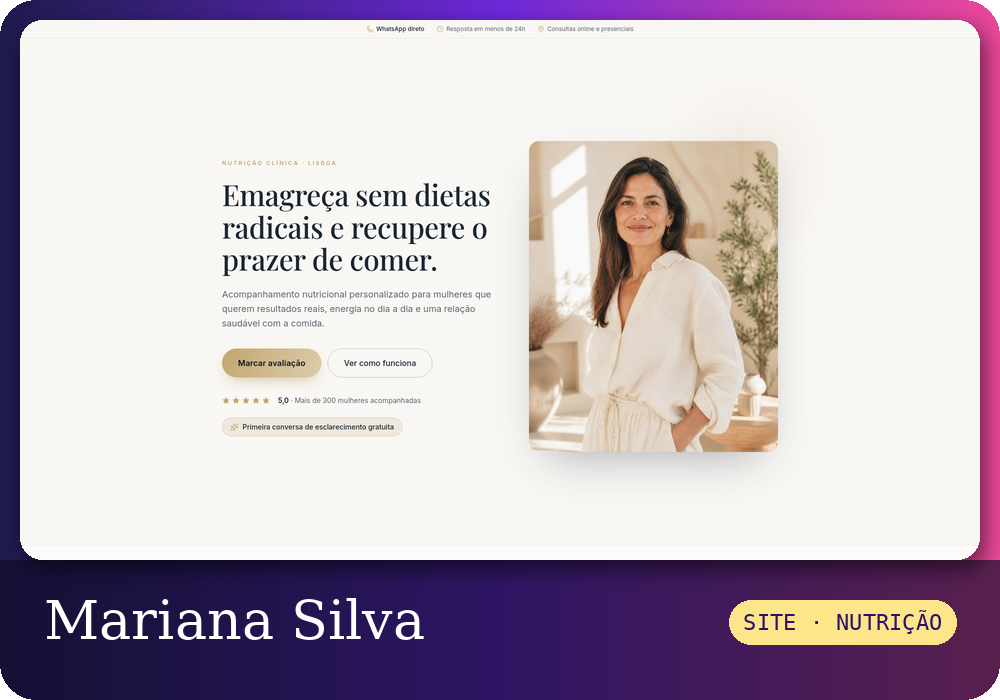

  

  

<h3 align="center">Numa viagem para criar coisas que fazem diferença na vida das pessoas... ✨</h3>

  

  

### Olá 👋

Sou a **Lenira**, criadora digital em Portugal 🇵🇹

Gosto de pegar numa ideia ainda sem forma e torná-la em algo **bonito e útil**: uma app que resolve um problema do dia a dia, um site que faz uma marca brilhar, uma formação que dá coragem a quem acha que "isto não é para mim" 💜

Uso a **inteligência artificial** como ferramenta de trabalho, do primeiro rascunho à app publicada. Mas cada projeto começa numa pessoa real.

Aquilo de que mais gosto:

- Criar apps e sites 🌐 com IA 🤖
- Acessibilidade ♿ e tecnologia que inclui
- Ensinar 🎓 e criar ebooks 📖, para que mais pessoas consigam

### Neste momento

🪄 A criar apps úteis com IA, do problema real à publicação

🎓 A preparar a **Academia ORIGEM**, uma app de estudo e de acompanhamento dos alunos

🔍 A aprender a fundo arquitetura de apps, bases de dados e testes automáticos

♿ A tornar cada projeto acessível a quem usa leitor de ecrã

`Novidade nov 2026:` O [BlueTime Agenda](https://agenda-fluxo-azul.lovable.app) ficou completo, com notificações, dois idiomas e testes automáticos. [Ler o caso de estudo](https://agenda-fluxo-azul.lovable.app/caso-de-estudo)

`Novidade nov 2026:` Publiquei a **[Voz Clara](https://tatodigital.lovable.app)**, que ajuda pessoas cegas ou com baixa visão no dia a dia: cores, cartas, documentos e onde estão.

### As minhas criações ✨

<a href="https://leniraleitao1929-leluel.github.io/leniraleitao1929-leluel/"><b>Abrir a página das minhas criações ↗</b></a>

<table>
<tr>
<td width="50%" valign="top">

**[Voz Clara](https://tatodigital.lovable.app)** 
APP · ACESSIBILIDADE

Para pessoas cegas ou com baixa visão: diz a cor da roupa, lê cartas e rótulos com a câmara, diz onde a pessoa está e lê documentos em voz alta. [Como foi feita](https://leniraleitao1929-leluel.github.io/leniraleitao1929-leluel/casos/voz-clara.html)

</td>
<td width="50%" valign="top">

**[BlueTime Agenda](https://agenda-fluxo-azul.lovable.app)** 
APP · SALÕES E BARBEARIAS

Marcações online com lembretes por WhatsApp e avisos para o salão. [Caso de estudo](https://agenda-fluxo-azul.lovable.app/caso-de-estudo) · [Como foi feito](https://leniraleitao1929-leluel.github.io/leniraleitao1929-leluel/casos/bluetime.html)

</td>
</tr>
<tr>
<td width="50%" valign="top">

**[VÉRTICE](https://vertice-ai-citizen.lovable.app)** 
APP · DOCUMENTOS OFICIAIS

Tira uma foto a uma carta das Finanças e explica o que é, quanto pagar e até quando.

</td>
<td width="50%" valign="top">

**[CLIENARA](https://clienara.lovable.app)** 
PLATAFORMA · AUTOMAÇÃO PARA EMPRESAS

Menos tarefas manuais, mais trabalho inteligente: o Excel de vendas dos clientes vira painéis, relatórios em PDF e respostas da IA, com a marca de cada parceiro. [Como foi feita](https://leniraleitao1929-leluel.github.io/leniraleitao1929-leluel/casos/clienara.html)

</td>
</tr>
<tr>
<td width="50%" valign="top">

**[Método ORIGEM](https://metodo-origem.lovable.app)** 
CURSO · 150 HORAS

Formação prática para transformar o teu conhecimento num projeto digital com Inteligência Artificial.

</td>
<td width="50%" valign="top">

**[Workshop ORIGEM](https://workshopoteutalentoencontrado.lovable.app)** 
WORKSHOP

Num sábado, online: crias o teu ebook de manhã e, à tarde, a página e o anúncio em vídeo.

</td>
</tr>
<tr>
<td width="50%" valign="top">

**[O Teu Talento Merece Ser Encontrado](https://ebookoteutalentomereceserencontrado.lovable.app)** 
EBOOK

O guia passo a passo para transformar o que sabes fazer num ebook, numa landing page e num anúncio.

</td>
<td width="50%" valign="top">

**[Pequenos Encantos](https://pequenosencantos.lovable.app)** 
MARCA · CONTOS MÁGICOS

Músicas personalizadas, vídeos encantados e memórias mágicas para emocionar famílias.

</td>
</tr>
<tr>
<td width="50%" valign="top">

**Mariana Silva Nutrition** 
SITE · PROTÓTIPO

Página para uma nutricionista, com marcação de consultas por WhatsApp.

</td>
<td width="50%"></td>
</tr>
</table>

<b>Ver as ferramentas com que crio</b>

 

  
  
  
  
  
  
  
  

### O meu ritmo no GitHub 📈

  

  

<h3 align="center"><a href="https://www.linkedin.com/in/lenira-tavares-363bb5269">Vamos falar no LinkedIn 💜</a></h3>
