<!-- Topo em onda animada -->

  

  

### 🤝 Vamos falar

  
  
  

### 💜 Sobre mim

- 🪄 Dou forma a ideias: **apps, sites e formações** com um toque de magia.
- 🤖 Uso a **inteligência artificial** como ferramenta de trabalho, do rascunho à app publicada.
- 💇‍♀️ Cada projeto nasce de **uma pessoa real**: uma cabeleireira, alguém que não consegue ler uma carta, uma marca que quer ser encontrada.
- 🎓 Criei o **Método ORIGEM** e ensino quem acha que "isto não é para mim".
- 🔒 Cuido do que não se vê: **dados protegidos, acessibilidade e testes**.
- 🇵🇹 Trabalho em **português de Portugal**.
- 🌱 Agora a aprender: arquitetura de apps, bases de dados e testes automáticos.

 

### ✨ A minha constelação de criações

  

| | Projeto | O que faz |
|:-:|---|---|
| 🔊 | **Voz Clara** | Lê em voz alta PDFs e fotografias de cartas para pessoas cegas ou com pouca visão. |
| 💇‍♀️ | **[BlueTime Agenda](https://agenda-fluxo-azul.lovable.app)** | Marcações online para salões, com lembretes por WhatsApp. [Caso de estudo](https://agenda-fluxo-azul.lovable.app/caso-de-estudo) |
| 🏛️ | **VÉRTICE: Inteligência Civil** | Explica em linguagem simples cartas oficiais portuguesas. *Em desenvolvimento.* |
| 📊 | **Insight Ally** | Painéis de vendas com a marca de cada parceiro, a partir de um Excel. *Em desenvolvimento.* |
| 🎓 | **Origem Premium** | Portal do curso *Empreender com Inteligência Artificial* (Método ORIGEM). |
| 🌟 | **Lenira's Luminous Creations** | Os meus workshops de criação web e de ebooks interativos. |
| 📖 | **O teu talento merece ser encontrado** | Ebook para criar landing pages no Lovable, passo a passo. |
| 🧚 | **Enchanted Tales Studio** | Sites com ambiente de conto de fadas para marcas de criança. |
| 🌍 | **Círculo Europa** | Landing page para apresentar uma oferta e captar contactos. |
| 🥗 | **Mariana Silva Nutrition** | Página para uma nutricionista, com marcação por WhatsApp. *Protótipo.* |

### 🛠️ Ferramentas com que crio

  
  
  
  
  
  
  
  

### 📈 O meu ritmo no GitHub

  

  

<!-- Rodapé em onda -->

  

