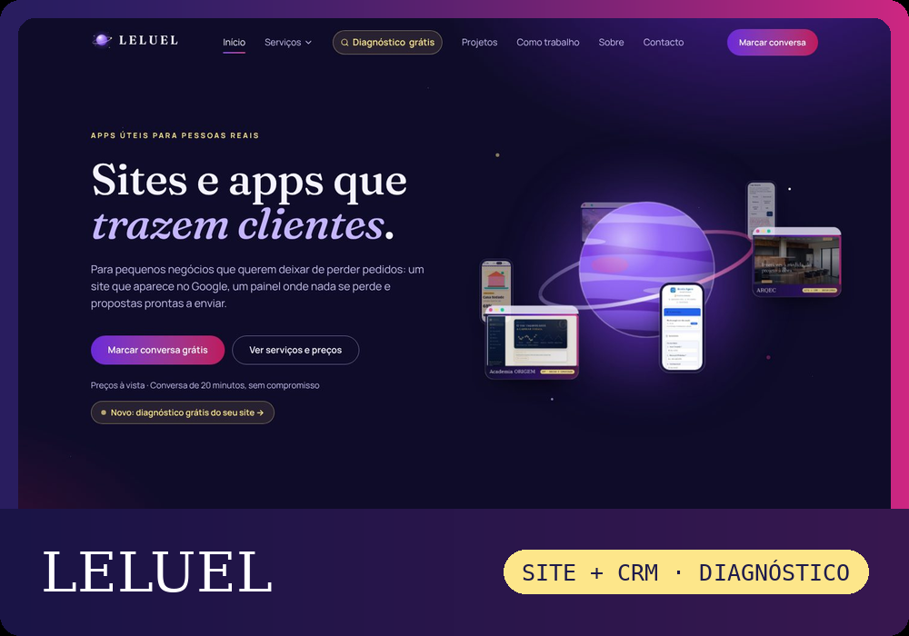
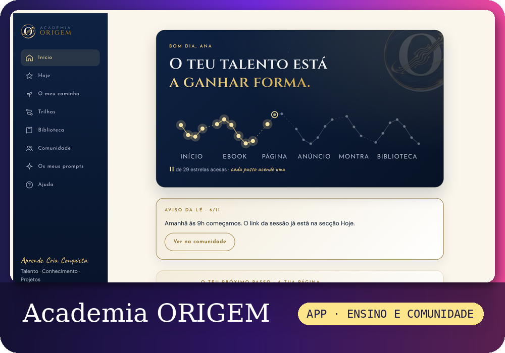
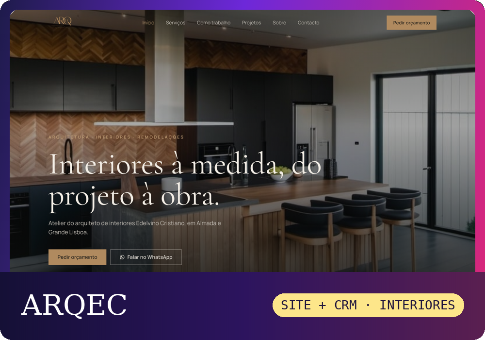
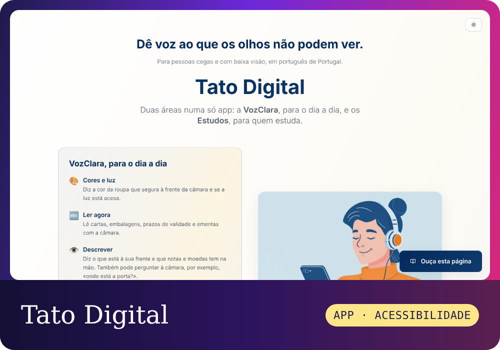
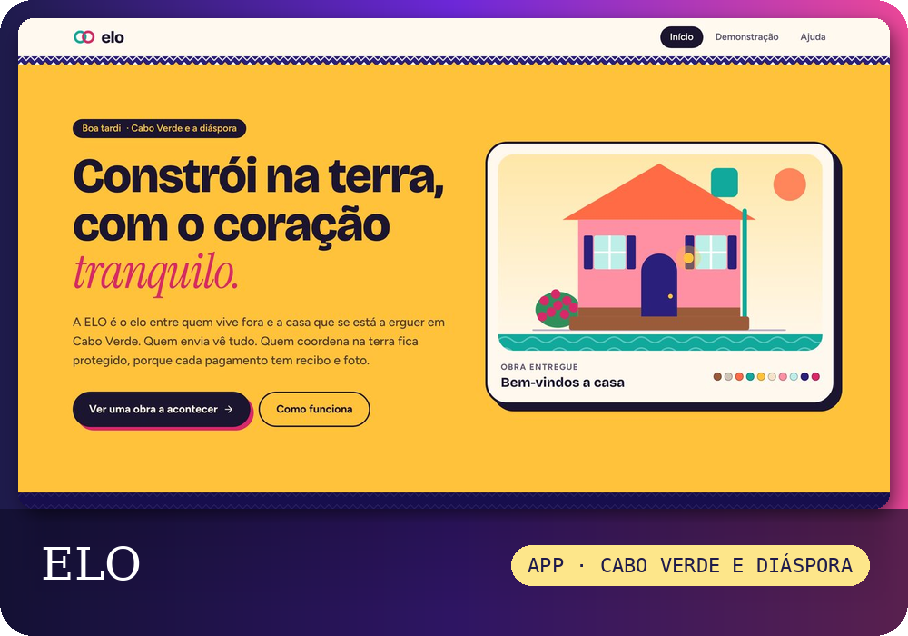
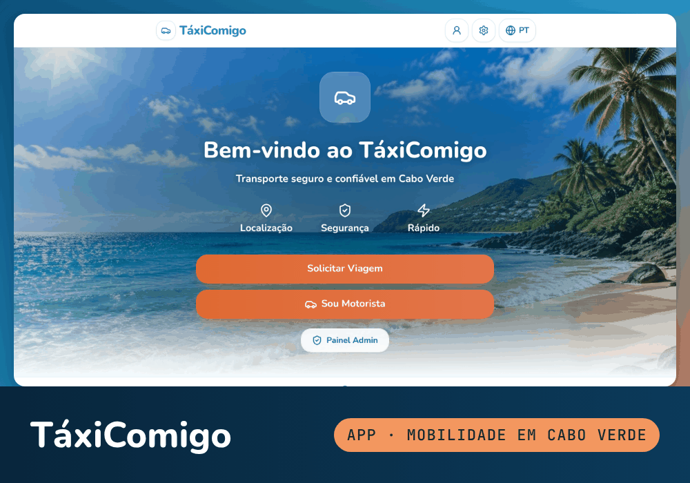

  

  

<h3 align="center">Numa viagem para criar coisas que fazem diferença na vida das pessoas... ✨</h3>

  

  

### Olá 👋

Sou a **Lenira**, criadora digital em Portugal 🇵🇹

Gosto de pegar numa ideia ainda sem forma e torná-la em algo **bonito e útil**: uma app que resolve um problema do dia a dia, um site que faz uma marca brilhar, uma formação que dá coragem a quem acha que "isto não é para mim" 💜

Uso a **inteligência artificial** como ferramenta de trabalho, do primeiro rascunho à app publicada. Mas cada projeto começa numa pessoa real.

Aquilo de que mais gosto:

- Criar apps e sites 🌐 com IA 🤖
- Acessibilidade ♿ e tecnologia que inclui
- Ensinar 🎓 e criar ebooks 📖, para que mais pessoas consigam

 

### O meu percurso

**Comunicar com quem está do outro lado.** Criei o **Pequenos Encantos**, uma marca de músicas personalizadas, vídeos encantados e contos mágicos para famílias, que hoje junta uma comunidade de **mais de 32 000 pessoas no Facebook** e **7 900 no Instagram**. Foi aí que aprendi a contar histórias que tocam as pessoas.

**Construir com inteligência artificial.** Comecei a criar apps e sites com IA e cada projeto nasceu de alguém real: a **Tato Digital** para a minha irmã, que é cega, a **ELO** para quem constrói casa em Cabo Verde a partir da diáspora, e o **BlueTime** em homenagem à minha mãe, **Cuxe Lopes**, cabeleireira durante mais de 30 anos, a quem ajudei muito no salão até ir para a universidade. Não paro no "parece pronto": testo no telemóvel, protejo os dados e corrijo até estar certo.

**Ensinar o que aprendo.** Criei o **Método ORIGEM**, o workshop e o ebook *O Teu Talento Merece Ser Encontrado*, para que mais pessoas transformem o que sabem num projeto digital.

  
  
  

 

### Neste momento

🪄 A criar apps úteis com IA, do problema real à publicação

🎓 A **Academia ORIGEM**, a plataforma de estudo do meu ebook e do meu workshop, já está publicada

🔍 A aprender a fundo arquitetura de apps, bases de dados e testes automáticos

♿ A tornar cada projeto acessível a quem usa leitor de ecrã

`Novidade nov 2026:` Fiz o site e o **CRM da minha marca, a [LELUEL](https://leluel.lovable.app)**: pedidos com próximo passo, clientes, projetos, pagamentos e mensalidades, propostas em PDF e um **diagnóstico grátis** que mede o site com a Google, envia o relatório por email e já deixa a proposta escrita. [Experimentar o CRM](https://leluel.lovable.app/demo) · [Como foi feito](https://leniraleitao1929-leluel.github.io/leniraleitao1929-leluel/casos/leluel.html)

`Novidade nov 2026:` Fiz o site e o CRM da **[ARQEC](https://arqec.lovable.app)**, atelier de arquitetura de interiores em Almada: os pedidos do site viram propostas em PDF com os preços, a margem e o IVA do atelier. [Como foi feito](https://leniraleitao1929-leluel.github.io/leniraleitao1929-leluel/casos/arqec.html)

`Novidade nov 2026:` A **Voz Clara** cresceu e passou a chamar-se **[Tato Digital](https://tatodigital.lovable.app)**, com duas áreas: a VozClara, para o dia a dia, e os Estudos, com os livros lidos página a página. [Como foi feita](https://leniraleitao1929-leluel.github.io/leniraleitao1929-leluel/casos/voz-clara.html)

`Novidade nov 2026:` Reconstruí o **[TáxiComigo](https://taxicomigo.lovable.app)**, o meu projeto de transporte para Cabo Verde, agora com contas reais e pedidos em tempo real. [Como foi feita](https://leniraleitao1929-leluel.github.io/leniraleitao1929-leluel/casos/taxicomigo.html)

`Novidade nov 2026:` Publiquei a **[ELO](https://elo-cabo-verde.lovable.app)**, para acompanhar a construção de uma casa em Cabo Verde a partir da diáspora. [Como foi feita](https://leniraleitao1929-leluel.github.io/leniraleitao1929-leluel/casos/elo.html)

`Novidade nov 2026:` O [BlueTime Agenda](https://agenda-fluxo-azul.lovable.app) ficou completo, com notificações, dois idiomas e testes automáticos. [Ler o caso de estudo](https://agenda-fluxo-azul.lovable.app/caso-de-estudo)

 

### As minhas criações

<table>
<tr>
<td colspan="2" valign="top">

**[LELUEL](https://leluel.lovable.app)** 
SITE + CRM + DIAGNÓSTICO · A MINHA MARCA

O meu site e o CRM por trás dele. Os pedidos chegam do site, do WhatsApp ou do Instagram e ganham um próximo passo; viram clientes, projetos em 7 passos, propostas em PDF e pagamentos com mensalidades. O diagnóstico grátis analisa 12 pontos de qualquer site, com a velocidade medida pela Google, envia o relatório por email e deixa a proposta escrita. Há um modo demonstração para mostrar nas reuniões. [Experimentar o CRM](https://leluel.lovable.app/demo) · [Como foi feito](https://leniraleitao1929-leluel.github.io/leniraleitao1929-leluel/casos/leluel.html)

</td>
</tr>
<tr>
<td colspan="2" valign="top">

**[Academia ORIGEM](https://academia-origem-preparacao.lovable.app)** 
APP · ENSINO E COMUNIDADE

A plataforma de estudo do meu ebook e do meu workshop. Cada aluna encontra as aulas, os prompts já preenchidos com as suas respostas, um passaporte de carimbos e a turma. No dia do workshop tem o horário ao vivo e um botão «Preciso de ajuda». Eu acompanho tudo num painel em tempo real, e a ligação à Hotmart dá e retira acessos sozinha. [Como foi feita](https://leniraleitao1929-leluel.github.io/leniraleitao1929-leluel/casos/academia-origem.html)

</td>
</tr>
<tr>
<td colspan="2" valign="top">

**[ARQEC](https://arqec.lovable.app)** 
SITE + CRM · ARQUITETURA DE INTERIORES

Site e CRM para o atelier do arquiteto de interiores Edelvino Cristiano, em Almada. Pedido de orçamento em 3 passos, maqueta 3D, painel de pedidos, tabela de preços com margem e propostas em PDF com a marca do atelier. [Como foi feito](https://leniraleitao1929-leluel.github.io/leniraleitao1929-leluel/casos/arqec.html)

</td>
</tr>
<tr>
<td width="50%" valign="top">

**[Tato Digital](https://tatodigital.lovable.app)** 
APP · ACESSIBILIDADE

Para pessoas cegas ou com baixa visão. A VozClara, para o dia a dia: diz a cor da roupa, lê cartas com a câmara, diz onde está e o que há perto. Os Estudos: livros lidos página a página, resumos e testes. [Como foi feita](https://leniraleitao1929-leluel.github.io/leniraleitao1929-leluel/casos/voz-clara.html)

</td>
<td width="50%" valign="top">

**[BlueTime Agenda](https://agenda-fluxo-azul.lovable.app)** 
APP · SALÕES E BARBEARIAS

Marcações online com lembretes por WhatsApp e avisos para o salão. Feita em homenagem à minha mãe, cabeleireira durante mais de 30 anos. [Caso de estudo](https://agenda-fluxo-azul.lovable.app/caso-de-estudo) · [Como foi feito](https://leniraleitao1929-leluel.github.io/leniraleitao1929-leluel/casos/bluetime.html)

</td>
</tr>
<tr>
<td colspan="2" valign="top">

**[ELO](https://elo-cabo-verde.lovable.app)** 
APP · CABO VERDE E DIÁSPORA

Para quem constrói casa em Cabo Verde a partir da diáspora. Cada envio e cada pagamento fica com data, recibo e foto, à vista de quem envia e de quem coordena na terra. A casa ganha cor a cada fase concluída. A ELO não mexe no dinheiro: só regista, organiza e mostra. [Como foi feita](https://leniraleitao1929-leluel.github.io/leniraleitao1929-leluel/casos/elo.html)

</td>
</tr>
<tr>
<td colspan="2" valign="top">

**[TáxiComigo](https://taxicomigo.lovable.app)** 
APP · MOBILIDADE EM CABO VERDE

Pedir um táxi por ilha e localidade, com o preço estimado em escudos e contacto por WhatsApp. Passageiro, motorista e administração, com pedidos em tempo real e regras de segurança testadas na base de dados. Desenhei-o em 2025 e reconstruí-o em 2026 a partir das capturas de ecrã. [Como foi feita](https://leniraleitao1929-leluel.github.io/leniraleitao1929-leluel/casos/taxicomigo.html)

</td>
</tr>
<tr>
<td width="50%" valign="top">

**[VÉRTICE](https://vertice-ai-citizen.lovable.app)** 
APP · DOCUMENTOS OFICIAIS

Tira uma foto a uma carta das Finanças e explica o que é, quanto pagar e até quando.

</td>
<td width="50%" valign="top">

**[CLIENARA](https://clienara.lovable.app)** 
PLATAFORMA · AUTOMAÇÃO PARA EMPRESAS

Menos tarefas manuais, mais trabalho inteligente: o Excel de vendas dos clientes vira painéis, relatórios em PDF e respostas da IA, com a marca de cada parceiro. [Como foi feita](https://leniraleitao1929-leluel.github.io/leniraleitao1929-leluel/casos/clienara.html)

</td>
</tr>
<tr>
<td width="50%" valign="top">

**[Método ORIGEM](https://metodo-origem.lovable.app)** 
CURSO · 150 HORAS

Formação prática para transformar o teu conhecimento num projeto digital com Inteligência Artificial.

</td>
<td width="50%" valign="top">

**[Workshop ORIGEM](https://workshopoteutalentoencontrado.lovable.app)** 
WORKSHOP

Num sábado, online: crias o teu ebook de manhã e, à tarde, a página e o anúncio em vídeo.

</td>
</tr>
<tr>
<td width="50%" valign="top">

**[O Teu Talento Merece Ser Encontrado](https://ebookoteutalentomereceserencontrado.lovable.app)** 
EBOOK

O guia passo a passo para transformar o que sabes fazer num ebook, numa landing page e num anúncio.

</td>
<td width="50%" valign="top">

**[Pequenos Encantos](https://pequenosencantos.lovable.app)** 
MARCA · CONTOS MÁGICOS

Vídeos animados e músicas personalizadas para famílias. Um vídeo chegou a 3,3 milhões de visualizações no Instagram. [Como foi feito](https://leniraleitao1929-leluel.github.io/leniraleitao1929-leluel/casos/pequenos-encantos.html)

</td>
</tr>
</table>

<b>Ver as ferramentas com que crio</b>

 

  
  
  
  
  
  
  
  

 

### O meu ritmo no GitHub 📈

  

  

 

### Vamos trabalhar juntos?

Se tem uma ideia, um negócio que precisa de um site ou de uma app, ou quer aprender a criar com IA, posso ajudar com:

- 🌐 **Sites e landing pages** que mostram bem a sua marca e trazem contactos;
- 📱 **Apps à medida**, com contas, base de dados e dados protegidos;
- 🎓 **Formação** para criar o seu próprio projeto digital com IA.

  

