  

  

  

### ✦ Olá, sou a Lenira

Gosto de pegar numa ideia ainda sem forma e torná-la em algo bonito e útil: uma app que resolve um problema do dia a dia, um site que faz uma marca brilhar, uma formação que dá coragem a quem acha que "isto não é para mim".

Uso a inteligência artificial como ferramenta de trabalho, mas cada projeto começa numa pessoa real: uma cabeleireira, alguém que não consegue ler uma carta, uma pequena marca que quer ser encontrada.

Trabalho em português de Portugal.

### ✦ A minha constelação de criações

  

<table>
<tr>
<td width="50%" valign="top">

**Voz Clara** 
APP · ACESSIBILIDADE

Lê em voz alta PDFs e fotografias de cartas que o telemóvel não consegue ler, para pessoas cegas ou com pouca visão.

</td>
<td width="50%" valign="top">

**[BlueTime Agenda](https://agenda-fluxo-azul.lovable.app)** 
APP · SALÕES E BARBEARIAS

Marcações online com lembretes por WhatsApp e avisos para o salão. Feito em homenagem a uma cabeleireira de 30 anos de profissão. [Caso de estudo](https://agenda-fluxo-azul.lovable.app/caso-de-estudo)

</td>
</tr>
<tr>
<td valign="top">

**VÉRTICE: Inteligência Civil** 
APP · EM DESENVOLVIMENTO

Explica em linguagem simples cartas e documentos oficiais portugueses: o que pedem, até quando e quanto.

</td>
<td valign="top">

**Insight Ally** 
PLATAFORMA · EM DESENVOLVIMENTO

Painéis de vendas com a marca de cada parceiro: as empresas carregam um Excel e veem os seus números.

</td>
</tr>
<tr>
<td valign="top">

**Origem Premium** 
FORMAÇÃO · MÉTODO ORIGEM

Portal do curso *Empreender com Inteligência Artificial*, com candidaturas e área de gestão. A Academia ORIGEM está em preparação.

</td>
<td valign="top">

**Lenira's Luminous Creations** 
FORMAÇÃO · WORKSHOPS

O meu espaço de workshops de criação web e de ebooks interativos.

</td>
</tr>
<tr>
<td valign="top">

**O teu talento merece ser encontrado** 
EBOOK

Ensina a criar landing pages no Lovable, passo a passo, com as páginas do livro para espreitar.

</td>
<td valign="top">

**Enchanted Tales Studio** 
SITE · MARCAS DE CRIANÇA

Sites com ambiente de conto de fadas: luz suave, partículas e uma experiência de cinema.

</td>
</tr>
<tr>
<td valign="top">

**Círculo Europa** 
SITE · CAPTAÇÃO DE CONTACTOS

Landing page elegante para apresentar uma oferta e transformar visitas em contactos.

</td>
<td valign="top">

**Mariana Silva Nutrition** 
SITE · PROTÓTIPO

Página para uma nutricionista, com marcação de consultas por WhatsApp.

</td>
</tr>
</table>

### ✦ Como gosto de trabalhar

- **Começo por quem vai usar**, não pela tecnologia.
- **Cuido do que não se vê**: segurança, dados protegidos, testes no telemóvel e no computador.
- **Faço bonito sem ser complicado**: cada ecrã tem de ser claro à primeira.
- **Ensino o que aprendo**, para que mais pessoas consigam criar.

### ✦ Ferramentas

  
  
  
  
  
  
  

✦ Feito com cuidado, em Portugal ✦

