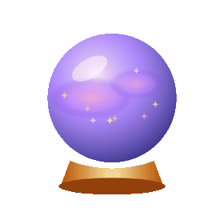
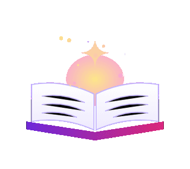

  

  

<h3 align="center">Dou forma a ideias, com inteligência artificial e um toque de magia ✨</h3>

  

### Olá 👋

Sou a **Lenira**, criadora digital em Portugal 🇵🇹

Gosto de pegar numa ideia ainda sem forma e torná-la em algo **bonito e útil**: uma app que resolve um problema do dia a dia, um site que faz uma marca brilhar, uma formação que dá coragem a quem acha que "isto não é para mim" 💜

Uso a **inteligência artificial** como ferramenta de trabalho, do primeiro rascunho à app publicada. Mas cada projeto começa numa pessoa real.

Aquilo de que mais gosto:

- Criar apps e sites 🌐 com IA 🤖
- Acessibilidade ♿ e tecnologia que inclui
- Ensinar 🎓 e criar ebooks 📖, para que mais pessoas consigam

 

### Neste momento

🪄 A criar apps úteis com IA, do problema real à publicação

🎓 A preparar a **Academia ORIGEM** e o curso *Empreender com Inteligência Artificial*

🔍 A aprender a fundo arquitetura de apps, bases de dados e testes automáticos

♿ A tornar cada projeto acessível a quem usa leitor de ecrã

`Novidade nov 2026:` O [BlueTime Agenda](https://agenda-fluxo-azul.lovable.app) ficou completo, com notificações, dois idiomas e testes automáticos. [Ler o caso de estudo](https://agenda-fluxo-azul.lovable.app/caso-de-estudo)

`Novidade nov 2026:` Publiquei a **Voz Clara**, que lê em voz alta documentos para pessoas cegas ou com pouca visão.

 

### As minhas criações ✨

<b>Ver as apps</b>

 

| | App | O que faz |
|:-:|---|---|
| 🔊 | **Voz Clara** | Lê em voz alta PDFs e fotografias de cartas que o telemóvel não consegue ler, para pessoas cegas ou com pouca visão. |
| 💇‍♀️ | **[BlueTime Agenda](https://agenda-fluxo-azul.lovable.app)** | Marcações online para salões e barbearias, com lembretes por WhatsApp. [Caso de estudo](https://agenda-fluxo-azul.lovable.app/caso-de-estudo) |
| 🏛️ | **VÉRTICE: Inteligência Civil** | Explica em linguagem simples cartas oficiais portuguesas. *Em desenvolvimento.* |
| 📊 | **Insight Ally** | Painéis de vendas com a marca de cada parceiro, a partir de um Excel. *Em desenvolvimento.* |

<b>Ver a formação e os ebooks</b>

 

| | Projeto | O que é |
|:-:|---|---|
| 🎓 | **Origem Premium** | Portal do curso *Empreender com Inteligência Artificial* (Método ORIGEM). |
| 🌟 | **Lenira's Luminous Creations** | Os meus workshops de criação web e de ebooks interativos. |
| 📖 | **O teu talento merece ser encontrado** | Ebook para criar landing pages no Lovable, passo a passo. |

<b>Ver os sites para clientes</b>

 

| | Site | Para quem |
|:-:|---|---|
| 🧚 | **Enchanted Tales Studio** | Sites com ambiente de conto de fadas para marcas de criança. |
| 🌍 | **Círculo Europa** | Landing page para apresentar uma oferta e captar contactos. |
| 🥗 | **Mariana Silva Nutrition** | Página para uma nutricionista, com marcação por WhatsApp. *Protótipo.* |

<b>Ver as ferramentas com que crio</b>

 

  
  
  
  
  
  
  
  

### O meu ritmo no GitHub 📈

  

  

<h3 align="center"><a href="https://www.linkedin.com/in/lenira-tavares-363bb5269">Vamos falar no LinkedIn 💜</a></h3>
