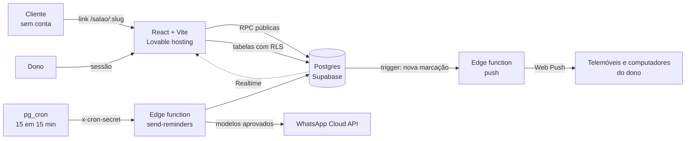

<a href="../README.md">← Voltar ao perfil</a>

# BlueTime Agenda

Marcações online para salões, barbearias e espaços de estética, em Portugal.
O dono cria a conta e recebe um link de marcação próprio; os clientes marcam por esse link,
sem criar conta, e recebem lembretes por WhatsApp.

**App:** https://agenda-fluxo-azul.lovable.app · **Caso de estudo:** [/caso-de-estudo](https://agenda-fluxo-azul.lovable.app/caso-de-estudo) · **Exemplo:** [barbearia de demonstração](https://agenda-fluxo-azul.lovable.app/demo/barbearia-classic)

> Versão de demonstração (portefólio): todas as funcionalidades estão abertas e os pagamentos não estão ativos.

---

## O que faz

**Para o cliente (sem conta)**
- Escolhe o serviço, o profissional (opcional) e uma hora livre, no telemóvel.
- Recebe lembrete por WhatsApp na véspera e 3 horas antes, no idioma em que marcou.
- Cancela ou remarca pelo link que recebe, sem telefonemas.

**Para o dono**
- Agenda, marcações com filtros e pesquisa, clientes com histórico e faltas.
- Equipa, horários semanais, pausas, folgas e feriados.
- Regras por serviço: tempo de preparação e de limpeza, intervalo entre marcações, limite por dia,
  profissionais que o fazem e horas em que pode ser marcado.
- Página de marcação com as cores, o logótipo e o link do espaço.
- Relatório mensal em PDF e Excel, faturação por profissional e por serviço.
- Stock de produtos com alerta de mínimos.
- Português e Inglês, escolhido por cada pessoa.
- Notificações com som no telemóvel ou no computador quando entra uma marcação, mesmo com a app fechada.

## Arquitetura

| Camada | Escolha |
|---|---|
| Interface | React 18, TypeScript, Vite, Tailwind, shadcn/ui |
| Dados e autenticação | Supabase (Postgres, Auth, Storage, Realtime, Edge Functions) |
| Datas | `date-fns-tz`, sempre em `Europe/Lisbon` |
| Exportação | jsPDF e ExcelJS, carregados só quando se descarrega |
| Notificações | Web Push com service worker próprio e Supabase Realtime |
| Testes | Vitest (regras), Playwright (fluxos no browser, computador e telemóvel) e axe (acessibilidade) |

## Decisões técnicas

**Dois clientes não conseguem ficar com a mesma hora.** A página só mostra horas livres, mas isso não chega: dois
clientes podem carregar em "Confirmar" no mesmo segundo. A marcação é criada por uma função na base de dados
(`create_public_booking`) que bloqueia a agenda do espaço (`pg_advisory_xact_lock`), volta a calcular as horas livres
e só então grava. Se a hora já foi ocupada, devolve `slot_taken` e a página pede outra hora.

**As regras de cada serviço contam nas horas livres.** O mesmo cálculo das horas livres
(`_compute_available_slots`) é usado para mostrar horas, criar e remarcar. Cada marcação ocupa da preparação até ao fim
do intervalo obrigatório; um serviço que atingiu o limite do dia deixa de ter horas; só aparecem os profissionais
escolhidos e, se houver, só as horas permitidas para esse serviço.

**Cada espaço só vê os seus dados.** Todas as tabelas têm Row Level Security por `business_owner_id`, com
`(select auth.uid())` para a verificação ser feita uma vez por pedido. Quem não tem sessão só lê as seis tabelas que a
página pública usa (perfil do salão, serviços, destaques e demonstrações); o resto chega-lhe apenas por funções
`SECURITY DEFINER` que devolvem o necessário (por exemplo, `get_public_staff` devolve nome e cargo, sem telefones nem
emails). Os ficheiros (logótipos, capas) só podem ser alterados pelo dono.

**O histórico nunca se perde.** Apagar um cliente ou um serviço com marcações é bloqueado na base de dados
(`ON DELETE RESTRICT`). Para pedidos de eliminação ao abrigo do RGPD, `anonymize_client` apaga os dados pessoais e
mantém as marcações, para a faturação e os relatórios continuarem certos.

**Só os donos criam conta.** Ao registar-se, um trigger cria o perfil, o espaço e um link único a partir do nome
(`Salão Água Clara` → `/salao/salao-agua-clara`). O cliente nunca precisa de conta.

**Avisos de novas marcações, mesmo com a app fechada.** Quando um cliente marca pelo link, um trigger na base de dados
chama a função `push`, que envia uma notificação Web Push (com som) a todos os dispositivos do dono que a ativaram.
As chaves VAPID são criadas pela própria função e ficam guardadas na base de dados, fora do código. Com a app aberta,
qualquer página da área de gestão mostra o aviso e atualiza as listas em tempo real.

**Lembretes sem spam.** Só recebe quem deu consentimento ao marcar. O `pg_cron` chama a função de envio de 15 em 15
minutos com um segredo verificado na base de dados; cada lembrete é marcado como enviado e, depois de 3 falhas,
deixa de ser tentado. Sem credenciais da Meta, os lembretes aparecem no painel para enviar com um toque.

**Acessível.** Todas as páginas, públicas e de gestão, passam a verificação axe (WCAG 2.1 AA) sem problemas graves,
no computador e no telemóvel. A verificação faz parte dos testes automáticos.

**Traduções verificadas.** O texto português é a chave (`t('Guardar')`) e o inglês está em `src/i18n/en.ts`, carregado
só por quem usa inglês. Um teste percorre o código e falha se algum texto ficar sem tradução.

## Em números

| | |
|---|---|
| TypeScript | cerca de 15 800 linhas |
| SQL | cerca de 8 300 linhas, em 123 migrações |
| Testes | 70 (31 às regras, 39 no browser, incluindo 22 páginas verificadas quanto a acessibilidade) |
| Traduções | 1 145 textos em português e inglês |

## Em falta (honestamente)

- Pagamentos (Stripe) em modo de teste; ativam-se com `VITE_BILLING_ENABLED=true`.
- Envio automático por WhatsApp à espera da aprovação dos modelos na Meta.
- Preço por dia e hora (preço dinâmico): ficou fora; o preço é o do serviço.
- Domínio próprio e monitorização de erros.
- No Supabase: ativar a proteção contra palavras-passe expostas e atualizar o Postgres.
- Utilizadores reais: o próximo passo é pôr um ou dois salões a usar e medir faltas antes e depois.

---

Feito por Lenira Leitão, em homenagem a Cuxe Lopes, cabeleireira durante mais de 30 anos.
