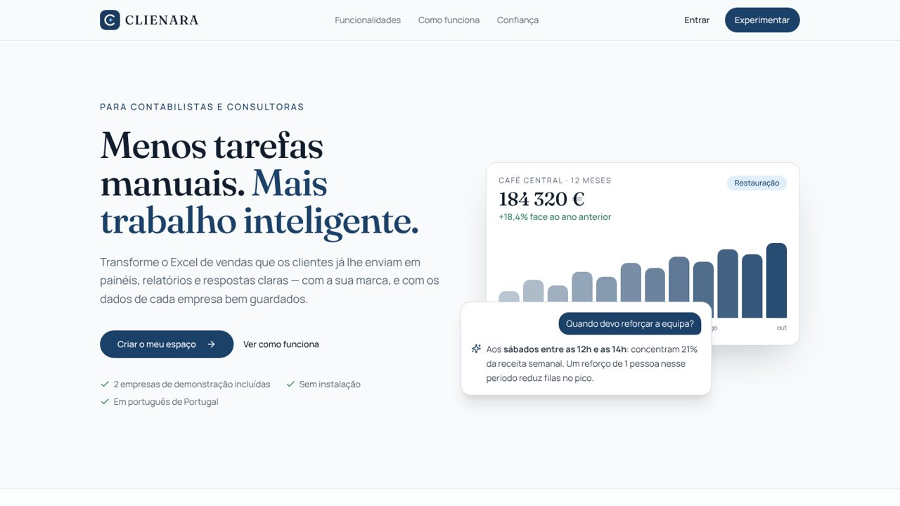
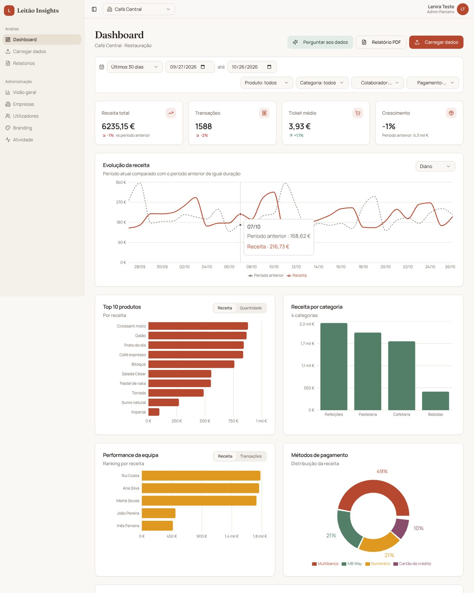
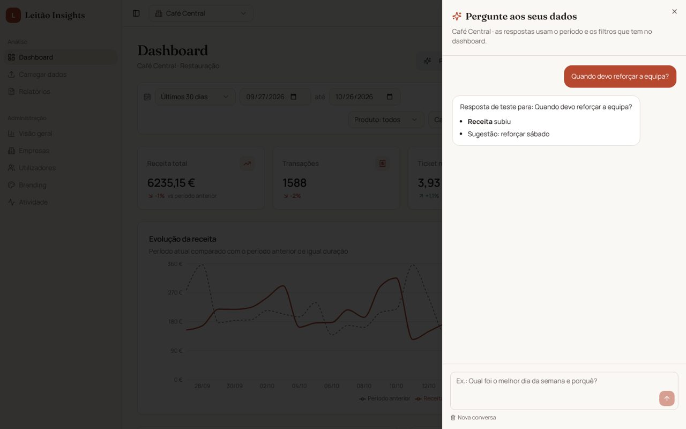
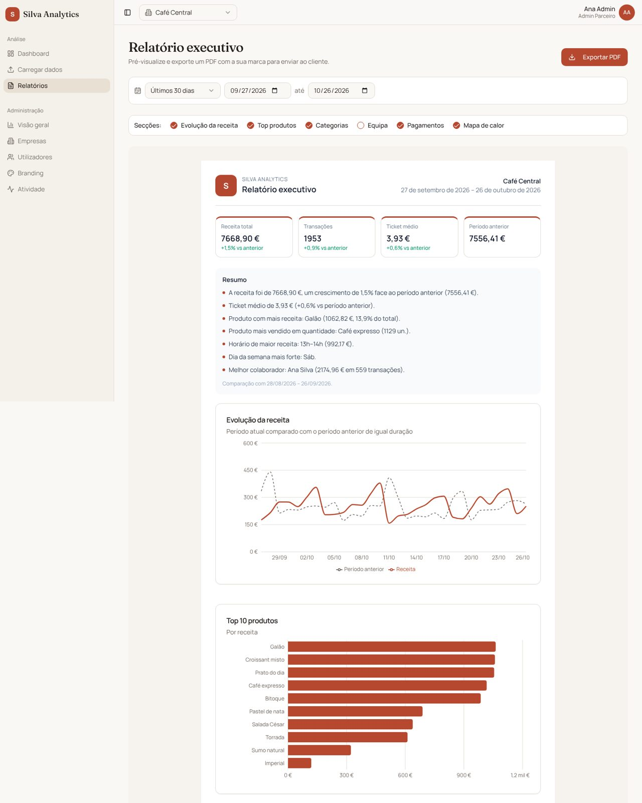
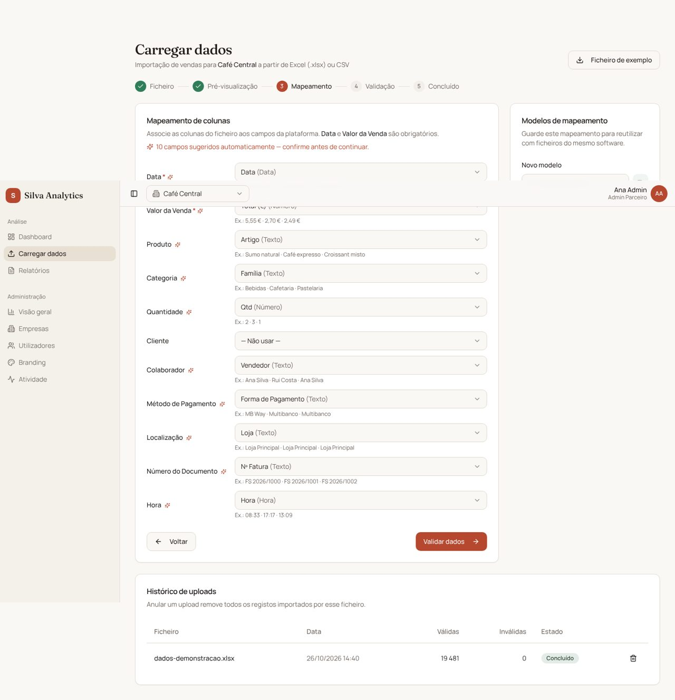
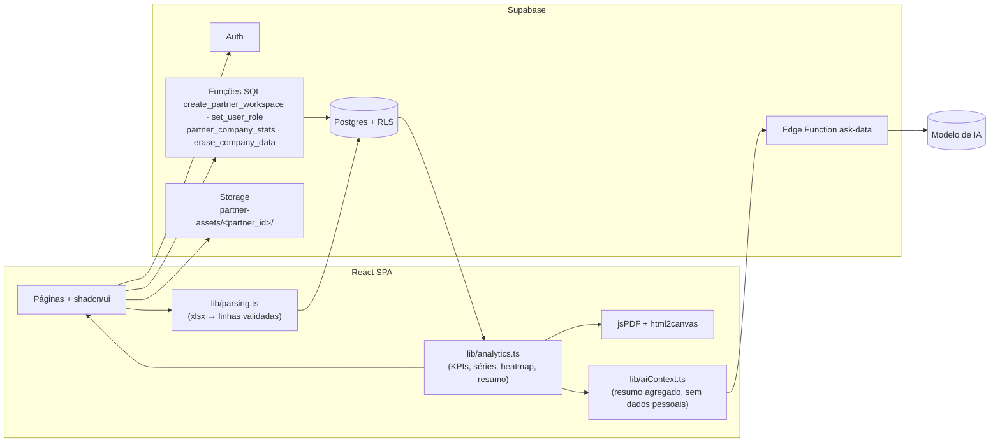
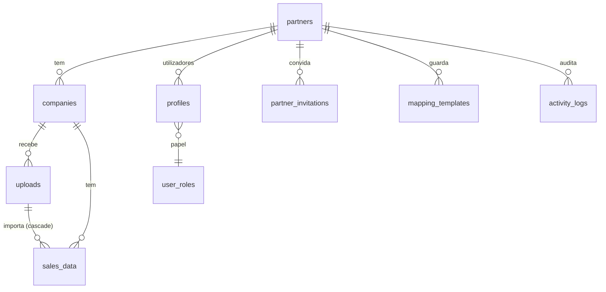

<p align="center"><a href="../README.md">← Voltar ao perfil</a></p>

# CLIENARA

**Menos tarefas manuais. Mais trabalho inteligente.**

[Abrir a app](https://clienara.lovable.app) · Projeto de Lenira Leitão

Plataforma SaaS B2B, com IA, onde **parceiros** (gabinetes de contabilidade, consultoras, software houses) oferecem dashboards e relatórios de vendas **com a sua própria marca** às empresas que são seus clientes.

O parceiro carrega o Excel/CSV exportado do software de faturação do cliente. A plataforma valida os dados e gera automaticamente os dashboards e o relatório executivo em PDF. Os dados de cada parceiro e de cada empresa ficam isolados na base de dados.



| Painel com a marca do parceiro | Pergunte aos seus dados (IA) |
|---|---|
|  |  |
| **Relatório executivo em PDF** | **Mapeamento inteligente de colunas** |
|  |  |

> Nas imagens, cada parceiro usa a sua marca (por exemplo "Leitão Insights" ou "Silva Analytics"): é isso que o white-label permite.

## Funcionalidades

| Área | O que faz |
|---|---|
| **Multi-tenant** | Hierarquia Super Admin → Parceiro → Empresa → Utilizador. Todas as tabelas têm `partner_id`/`company_id`. O isolamento é imposto por Row Level Security no Postgres. |
| **Papéis** | **Admin Parceiro** gere empresas, utilizadores e branding. **Gestor Empresa** carrega dados e analisa. **Visualizador** só consulta. Gestores e visualizadores podem ficar limitados a uma empresa. |
| **Onboarding e convites** | Quem cria conta configura o seu espaço de parceiro, opcionalmente com 2 empresas de demonstração (14 meses de dados). Os convites por email atribuem papel e empresa no registo. |
| **White-label** | Logótipo, cor primária e secundária, nome da plataforma e título do dashboard. A marca é aplicada em toda a interface, no título e favicon do browser e no PDF. Há pré-visualização ao vivo. |
| **Upload universal** | `.xlsx`/`.csv` (UTF-8 ou Windows-1252). Pré-visualização das 10 primeiras linhas, com deteção do tipo de cada coluna (data, número, hora, texto). |
| **Mapeamento inteligente** | Sugere a coluna para cada campo interno a partir do nome (PT/EN) e do tipo detetado. Só avança com Data e Valor definidos. Os modelos de mapeamento podem ser guardados e reutilizados. |
| **Processamento** | Datas convertidas para ISO (dd/mm/aaaa, séries Excel, datetime). Valores convertidos para número (`1.234,56 €`, `(12,50)`…). Relatório de linhas válidas e inválidas, com o motivo de cada rejeição. Importação por lotes com rollback. O histórico permite anular um upload. |
| **Dashboard modular** | KPIs com crescimento vs período anterior, evolução diária/semanal/mensal comparada com o período anterior, Top 10 produtos (receita e quantidade), categorias, equipa (receita e nº de transações), métodos de pagamento (donut) e mapa de calor dia × hora. Cada módulo só aparece se o campo correspondente existir nos dados. |
| **Filtros globais** | Período (com presets), produto, categoria, colaborador e método de pagamento. Atualizam todos os módulos em tempo real. |
| **Pergunte aos seus dados (IA)** | O cliente escreve perguntas em português ("porque caíram as vendas?", "quando reforçar a equipa?") e recebe respostas baseadas nos números do período e dos filtros ativos. Só são enviados totais agregados, nunca vendas individuais nem dados de clientes. A chamada à IA corre numa edge function autenticada e cada pergunta fica no registo de auditoria. |
| **Relatório PDF** | Logótipo e cores do parceiro, empresa, período, KPIs, gráficos escolhidos e resumo automático (crescimento, produto líder, horário de maior receita, dia mais forte, melhor colaborador). |
| **Painel do parceiro** | Empresas ativas, receita agregada, empresas em queda de receita e empresas sem upload há mais de 30 dias, ordenadas por prioridade. |
| **Segurança e RGPD** | Registo de auditoria gerado por triggers. Exportação dos dados pessoais e dos dados de cada empresa (CSV). Apagamento integral dos dados de uma empresa. Política de privacidade. |


## Arquitetura





### Modelo de segurança

- As regras de acesso estão em **policies RLS**, não só na interface. Os helpers `SECURITY DEFINER` (`get_user_partner_id`, `has_role`, `can_access_company`) evitam recursão nas policies.
- Os utilizadores só podem alterar o próprio `full_name` (privilégio de coluna). `partner_id`, `company_id` e papéis só mudam através de funções que validam quem chama.
- Os papéis são atribuídos com `set_user_role()`: um admin só gere utilizadores do seu parceiro e ninguém pode atribuir `super_admin`.
- No storage, cada parceiro só escreve na pasta `<partner_id>/`.
- Ao apagar um upload, as linhas que ele importou são apagadas em cascata.

Os testes de segurança contêm **22 verificações** de isolamento. Entre elas: um parceiro não lê nem escreve dados de outro; um utilizador não muda o próprio `partner_id` nem se promove; um visualizador não escreve; um gestor só vê a empresa que lhe foi atribuída.


### Testes

- **Unitários** (`npm test`, 39 testes): conversão de datas e valores em formato PT, deteção de tipos, mapeamento automático (incluindo o ficheiro de exemplo completo), KPIs, séries temporais, heatmap, resumo automático e contexto enviado à IA (incluindo a garantia de que não leva dados pessoais).
- **Segurança** (`supabase/tests/rls_test.sql`): 22 verificações de isolamento multi-tenant, validadas num Supabase local (Postgres 17).
- **Ponta a ponta**: percurso completo no browser com Playwright (registo, onboarding com dados demo, filtros, upload, PDF, branding, convite e acesso restrito de um visualizador).


## Roadmap

- Envio de convites e relatórios por email (Resend) e relatórios agendados
- Ligação direta a software de faturação (SAF-T PT, APIs de POS) em vez de upload manual
- Subdomínio e domínio próprio por parceiro
- Agregações no servidor para volumes muito grandes


---

## Como foi construída

O que aprendi a fazer esta app, com os problemas reais e as soluções.

## Lição 1 — Uma app "bonita" não é uma app pronta

A primeira versão foi gerada pelo Lovable. Tinha login, menus e páginas, e parecia completa. Uma revisão do código mostrou outra realidade:

- a página de relatórios dizia "será implementada em breve";
- um utilizador novo não tinha empresa nem papel, por isso via tudo vazio;
- valores como `1.234,56 €` eram guardados como `1,23`.

**O que aprendi:** antes de mostrar um projeto, abro cada página e faço o percurso completo como se fosse um cliente: criar conta → carregar dados → ver o resultado.

**Prompt útil:**
> Revê o projeto como um utilizador novo. Lista, por página, o que está implementado, o que é só visual e o que falha. Não alteres nada ainda.

---

## Lição 2 — Segurança multi-cliente: o erro que ninguém vê

Numa plataforma com vários clientes, cada um só pode ver os seus dados. A primeira versão tinha regras de segurança (RLS) na base de dados, mas uma delas deixava cada pessoa **editar o próprio perfil por inteiro**, incluindo o campo `partner_id`. Na prática, qualquer pessoa que criasse conta podia mudar esse campo e ler as vendas de qualquer parceiro.

Isto foi provado num teste antes de ser corrigido:

```sql
-- utilizador desconhecido muda o seu partner_id para o da vítima…
UPDATE profiles SET partner_id = '<id da vítima>' WHERE user_id = auth.uid();
-- …e passa a ler as vendas dela
SELECT sum(amount) FROM sales_data;  -- 999.00
```

**A solução:**

- O utilizador só pode alterar o próprio nome:
  ```sql
  REVOKE UPDATE ON profiles FROM authenticated;
  GRANT UPDATE (full_name) ON profiles TO authenticated;
  ```
- Mudar de parceiro, empresa ou papel só é possível através de funções na base de dados que verificam quem está a pedir (`set_user_role`, `create_partner_workspace`).
- Há um ficheiro de testes, `supabase/tests/rls_test.sql`, com 22 verificações. Por exemplo: o parceiro B não lê o parceiro A, um visualizador não escreve e um gestor só vê a sua empresa.

**O que aprendi:** "tem RLS" não quer dizer "está seguro". É preciso **tentar entrar como atacante** e confirmar que falha.

**Prompt útil:**
> Escreve um teste SQL que crie dois parceiros e prove que um não consegue ler, escrever nem mudar papéis no outro. Inclui tentativas de alterar o próprio partner_id e de se atribuir um papel de administrador.

---

## Lição 3 — Regras de segurança também podem ser lentas

Com 32 mil vendas, o painel do parceiro demorava **10,8 segundos**. A causa era a regra de segurança chamar uma função **para cada linha**.

**A solução:** calcular uma vez a lista de empresas a que o utilizador tem acesso e comparar com essa lista:

```sql
-- antes: avaliado 32 000 vezes
USING (public.can_access_company(company_id))
-- depois: avaliado uma vez por consulta
USING (company_id IN (SELECT public.accessible_company_ids()))
```

Resultado: **46 milissegundos**.

**O que aprendi:** testar sempre com volume realista. Uma app com 10 linhas de exemplo esconde problemas que só aparecem com dados reais.

---

## Lição 4 — Dados portugueses são diferentes

Os ficheiros que os clientes exportam trazem:

- datas `05/03/2026` (dia primeiro);
- valores `1.234,56 €`;
- CSV gravado em Windows-1252, com acentos estragados;
- colunas chamadas "Artigo", "Família", "Qtd" ou "Total (€)".

**A solução** está em `src/lib/parsing.ts` e faz quatro coisas:

1. Converte datas para o formato ISO, aceitando também números de série do Excel.
2. Converte valores em formato PT para número.
3. Deteta o tipo de cada coluna (data, número, hora ou texto).
4. **Sugere o mapeamento** de cada coluna pelo nome e pelo tipo. Depois, mostra linha a linha porque é que uma linha foi rejeitada ("Linha 14: Valor inválido: "grátis"").

**O que aprendi:** a parte "aborrecida" (limpar dados) é a que faz o cliente confiar no resultado. E é muito fácil de testar automaticamente. Há 34 testes só para isto e para os cálculos.

---

## Lição 5 — IA útil, com privacidade

O botão "Perguntar aos dados" deixa o cliente escrever, por exemplo, *"Quando devo reforçar a equipa?"*.

**A decisão importante foi o que é enviado à IA:**

- **não** são enviadas as vendas individuais, nem os clientes, nem os números de documento;
- é enviado **um resumo agregado** (`src/lib/aiContext.ts`): totais, crescimento, receita por produto, por dia da semana e por hora, e os picos de faturação;
- um teste garante que esse resumo não contém dados pessoais e que não ultrapassa o tamanho máximo.

A chamada à IA acontece numa *edge function* (`supabase/functions/ask-data`). Assim, nenhuma chave fica no browser. A função também verifica se o utilizador tem sessão e regista cada pergunta na auditoria.

As instruções dadas à IA (o "prompt de sistema") obrigam-na a:

- responder em português de Portugal;
- usar **apenas** os números recebidos e dizer quando não sabe;
- terminar com 1 ou 2 sugestões práticas.

**Prompt útil:**
> Cria uma edge function que receba uma pergunta e um resumo agregado dos dados, chame o modelo de IA com um prompt de sistema em português de Portugal que proíba inventar números, e devolva só a resposta. Valida a sessão do utilizador e limita o tamanho da pergunta.

---

## Lição 6 — Identidade própria

A identidade da CLIENARA nasceu com a ideia: um nome próprio, curto, que se diz bem em português e em inglês, e uma frase que resume o que a app faz pelo parceiro, «Menos tarefas manuais. Mais trabalho inteligente.»

- **Cores:**
  - azul-noite `#1B3A5F` como cor de ação e dos títulos;
  - azul-claro `#7CC4F0` / `#3BA3D9` como acento;
  - fundo branco-frio, para os números se lerem bem.
- **Tipografia:** *Fraunces* (serifa) nos títulos e *Manrope* no texto.
- **Barra lateral clara** em vez da escura habitual.
- **Ícone:** um "C" com uma pequena estrela, o trabalho inteligente.

O projeto começou com o nome Montra (paleta terracota). Ao mudar para CLIENARA, só foi preciso trocar o nome em `src/config/product.ts` e as cores em `src/index.css`, porque a identidade do produto está separada da marca de cada parceiro.

Como é white-label, cada parceiro troca as cores pelas suas. A identidade CLIENARA só aparece nas páginas públicas.

**Prompt útil:**
> Antes de criar componentes, define uma identidade: nome, 5 cores com função (fundo, texto, ação, secundária, alerta), 2 tipos de letra e um elemento visual distintivo. Evita azul-marinho e dourado. Aplica-a como variáveis CSS.

---

## Lição 7 — Provar que funciona

O que distingue um projeto de portfólio de um protótipo é a **prova**:

| Tipo de teste | Onde | O que garante |
|---|---|---|
| Unitários (39) | `src/test/` | conversões PT, mapeamento automático, KPIs, heatmap, resumo e contexto da IA |
| Segurança (22) | `supabase/tests/rls_test.sql` | isolamento entre parceiros e empresas |
| Ponta a ponta | Playwright, no browser | registo → dados demo → filtros → upload → PDF → convite → acesso restrito |

---
